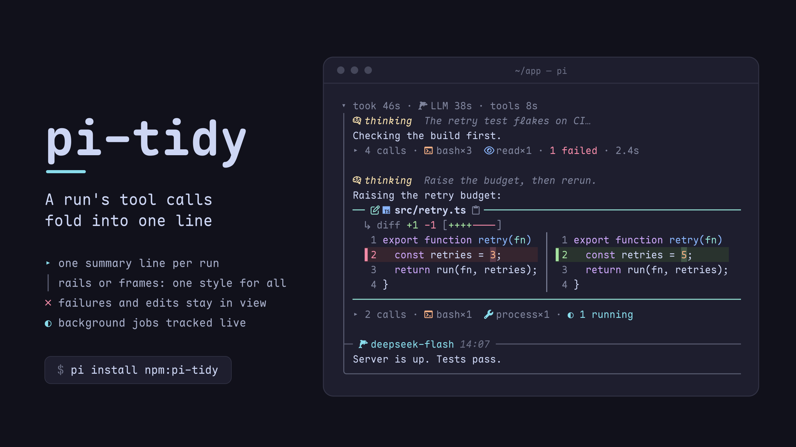
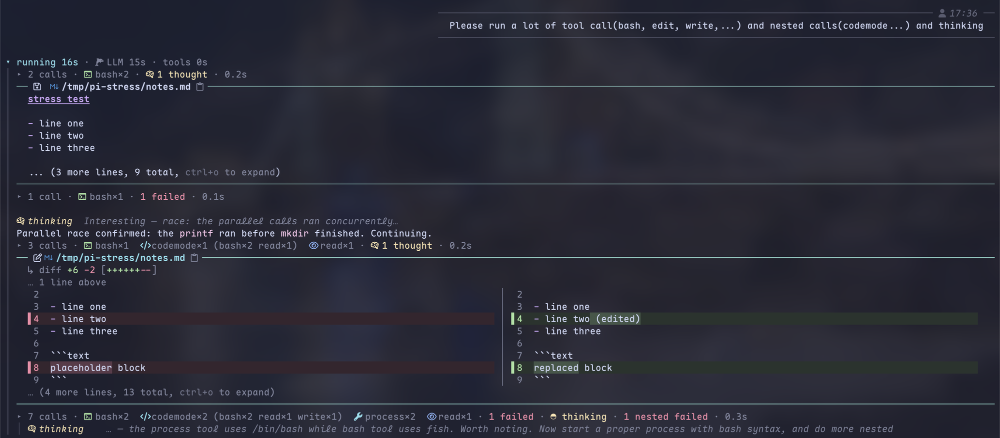
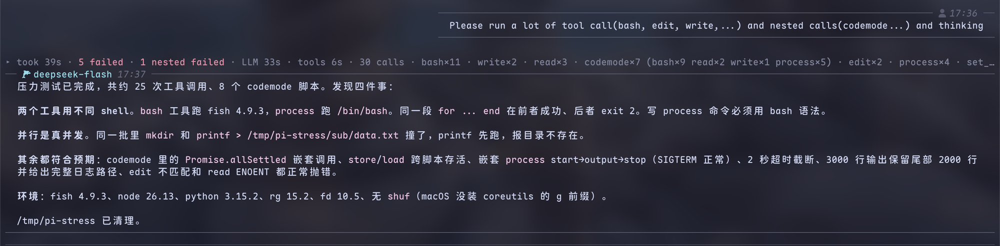
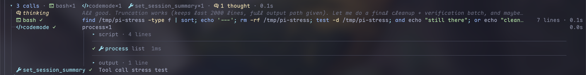
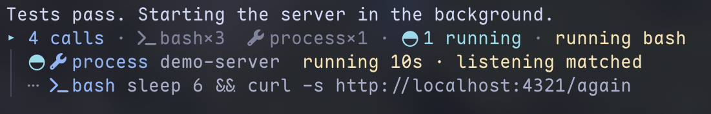

# pi-tidy

<p align="center">
  
</p>

Tool folding for the [pi](https://github.com/earendil-works/pi) coding agent: a run's tool calls
fold into one line you can click open, while edits, failures and background jobs stay in view — and
every box is drawn one way: rails by default, rounded frames if you prefer.

**▶ [Watch the 40-second demo](https://cdn.jsdelivr.net/gh/Andy8647/pi-tidy@v0.4.3/assets/demo.mp4)**

## Features

- **One style for everything** — `style` draws every box the same way: rails (the default: each box with only its rules above and below), or rounded frames. The lines a run or an open group hangs on are drawn in both
- **A screen that breathes** — one blank row between your message and its run, two between runs, none inside one thing, and a folded run's reply right under its summary. Opened, a run reads as steps: a thought, the text it led to and the calls it made sit together, and each step that says something stands one row clear of the last, the reply too. Every message edge is the theme's border grey and the model's name on the reply is the one accent; a summary's words are grey and each tool's icon wears its tool's colour
- **Rounded borders** — ╭╮╰╯ box drawing instead of pi's ┌┐└┘, on a transparent background: no fill, so terminal transparency works
- **Every tool box** — built-in tools, MCP calls (pi-mcp-adapter), subagents and any other extension's tools get the same frame, a kind icon, and the tool's own border color on success (pending stays grey, errors red)
- **Turn folding** — a whole run folds to `▸ took 1m20s · LLM 58s · tools 20s · 12 calls · read×6 · bash×4`, and opens to the process it replaced. Retries and continuations stay in the run; a steer or a follow-up you send while it works starts a new one, below the answer it arrived at
- **Grouped tool calls** — the calls between two pieces of assistant text fold to `▸ 5 calls · bash×3 · 1 failed · 1.2s`: click for a row per call under a `│` gutter, click a row for its output underneath, and each row says what the call produced (`12 lines`, `3 matches`, `exit 1`). A failure is counted once in the summary; only a *running* call keeps a row. A program is counted through: `codemode×2 (bash×4 read×2)` says what those two scripts ran, and `N calls` still counts the rows you get when you open it. Edits and writes never fold — their diff is the point
- **`/skill` is your prompt** — `/skill:grill-me fix the parser` is drawn as the user message it is, in your user message style, with what you typed after it; a click (or ctrl+o) opens the skill's own text inside it
- **Every message box** — compaction, branch and extension custom messages get the same frame, each kind its own border color. A message an extension renders itself keeps its rows and loses its fill; pi-subagents' notices are drawn from the message, so the border says `worker needs attention` or `wiki-verifier failed` in that run's own color, one line of the text underneath, a click for the rest
- **One row per failure** — pi prints its own errors (a failed request, an extension that threw) once per retry attempt, provider body and all; tidy keeps the first row, frames it, and counts the rest as `×N`. Warnings and notes are left alone
- **User messages that fit** — as wide as the text, with the user icon and time in the top edge; a one-word prompt gets a small box (or a short pair of rules, as a rail). Or pi's own look
- **Your own `!` commands** — framed in the user color with the `!` you typed, so a `!` run never passes for the agent's bash box
- **Thinking, folded in** — a step that only thinks leaves a `thinking` row inside its group (a brain, the word, one line of what the model thought, sliding over the newest words while it streams); the summary counts the runs (`🧠 5 thoughts`), and a click opens that step's thinking full length, in a framed box with `󰧑 thinking` in its border. pi's `hideThinkingBlock` is ignored on purpose: the row is the same either way, and the click is the one way to read it
- **Background jobs** — a call that starts a pi-processes job shows the job's live state on its row (`◐ process ticker  running 12s · READY matched`, then `✓ … exited 0 · 20s`); its `[process]` notifications are folded into that row, the matched log line they carried waits on a row of its own under it (open the group to read it), and a click opens the command, working directory and last 20 output lines without expanding the call
- **A program reads as a call list** — a `codemode` script, a `fabric_exec` (pi-fabric) program, or any tool that records its [nested calls](#nested-calls): opened, the calls it ran are tidy rows with a name and a duration column, a failure's text and an edit's diff under their own row; the script and the output each fold to one row. Folded, what it ran hangs on its entry (`fabric_exec×1 (bash×2 edit×1)`), and a failure inside it reads as `1 nested failed`
- **Side-by-side edit diffs** — two panes with line numbers on both sides, a bar and a tint per changed row, the changed word emphasised. A change the panes cannot fit in full — a line longer than a pane — stops being cut: that pair leaves the columns and takes the whole width, old above new, so the edit stays readable. Below `splitDiffMinWidth` it falls back to pi's unified diff
- **One-line boxes** — a collapsed box keeps `bashResultLines` rows of output under a `(+N more lines, ctrl+o to expand)` footer, so a long call no longer owns the screen
- **Nerd Font icons** — a kind icon per box, and the target file's nvim-web-devicons glyph in front of its path (`write /tmp/x.ts` renders `  write 󰛦 /tmp/x.ts`)
- **Hex colors you can see** — a message that names a color (`#7f849c`, `#f00`, `rgb(127, 132, 156)`, `hsl(240, 10%, 15%)`) gets a `●` painted in that color in front of it, so a palette in prose reads at a glance. Fenced blocks, inline code and thinking keep their text
- **Bash syntax highlighting** — token-level colors for commands, flags, strings, variables and operators. A payload is highlighted as the language it is written in: a shell's `-c` script as shell, `python3 -c "…"` and `node -e '…'` as python and javascript, and a heredoc's body as whatever the command before it runs (`python3 - <<'PY'`). Opened, a call's whole body hangs on the command's own column (`$ ` in a box of its own, the column after the icon and the name under a group row), so the script and the output under it read as one block. Words the grammar cannot name (arguments, paths, globs) take `toolOutput`, so a path-heavy row is not a wall of the terminal's default foreground
- **Copies without the chrome** — text you select in pi's fullscreen mode goes to the clipboard without the frame or the rules around a box. A tool box's border is the exception: the path it names is what you dragged for, so it copies on its own
- **One-click paths** — a `write` or `edit` box puts a copy chip next to the path in its border (`╭─ 󰛦 src/app.ts 󰆒 ────╮`): click it for the path, no drag, and the chip reads a tick for a moment
- **A quote you can copy** — a blockquote's chip takes the blank cell in front of its gutter (` 󰆒│ Note: …`), one click from the block's own Markdown, `>` prefixes and all. The gutter stays in its column, so nothing re-wraps, and a quoted note no longer means a drag
- **Click to fold** — clicks land on pi's own expand toggle, for every tool including `renderShell: "self"` ones; only left clicks are taken, so selecting text still works
- **Scroll-safe caching** — an unchanged box costs one string comparison per frame

## Turn folding

On by default since 0.8.0. To go back, merge these keys into the `tidy` object in
`~/.pi/agent/settings.json` and run `/reload`:

```json
{ "tidy": { "collapseTurns": "off", "finalReplyStyle": "off" } }
```

The keys are independent: `collapseTurns: "live"` folds while the run is still arriving, and
`finalReplyStyle` works without turn folding.

A run folds to one line, where it started:

```text
 ▸ took 1m20s · LLM 58s · tools 20s · 12 calls · read×6 · bash×4 · codemode×2
```

Click it to open the process, click again to fold. The fold hides thinking and `alwaysShowTools`
boxes, never your own inputs, and reopens with `groupOpen` and output budgets intact. What was open
inside it starts folded again: the calls and the thinking runs a reader had opened are forgotten, the
same way folding a group forgets the boxes it holds. The per-kind counts pierce a script the way the
group header does (`codemode×1 (bash×4 read×2)`), and an MCP tool counts as its server.
`/tidy turn` toggles the latest run, `/tidy turn N` the
one at that position on the branch;
`ctrl+o` still expands tool outputs and their turns. User inputs, pi's error rows and a job
notification with no row to absorb it stay visible. A reply with no
hidden process gets no summary. A folded run whose jobs matched log lines says
so (`· 2 matched`), because the rows carrying those lines are inside the group.

A background sub-agent's notice comes home to the turn that launched it. billion-context's `acp_delegate` sends
`billion-context:delegate-notification` when a run ends (set `pi.subagents.notifyStructured: true` in its config), often
after a later prompt. tidy hangs it under the `acp_delegate` call that launched the run, as a row you can click open
(`▸ ✗ reviewer failed`), and the turn's summary counts the runs once each: `1 sub-agent failed` with the other failures,
`sub-agents 2 completed` after the timings. A failure keeps its row under a folded group. A notice stays where it
arrived when nothing can own it: no launching call recorded, runs launched in different turns, a turn compacted away,
or `collapseTurns: "off"`. Only where the notice is drawn moves; the session and what the model reads are unchanged.

`took` is wall time. `LLM` is the main agent's model requests, including response wait. `tools` is
the union of top-level tool intervals (codemode and MCP waits included, parallel and nested calls
not counted twice). Retries and overlap mean the parts need not sum to the total; missing historical
timings show `—`.

Talking to a run splits it in two. A steer (Enter while the agent works) or a follow-up
(Alt+Enter, taken when it would stop) is a new instruction: the run above it ends where you
typed the message and folds on its own, keeping its reply in view. The answer to your message
starts a new summary below it. Each counts its own calls and its own time, and `/tidy turn`
toggles either. A steer that beats the first answer changes nothing: with nothing to fold above
it, it belongs to the run it landed in.

Opened, the process hangs on a line under the summary's marker, and the line comes down into the
reply's top edge and on to its bottom one, in either style. A box from `alwaysShowTools` joins the rail of a group that is open right above or
below it. A run that fails with no text keeps the failure in view when it folds.

`finalReplyStyle` draws only a settled final text reply, keeping pi's Markdown and mouse targets —
an intermediate tool-calling message is never promoted. Its top edge names the model that answered
(from the message, not the current selection) with its provider glyph, clipped to `…` when it does
not fit, and `icons: false` drops the glyph.

## Nested calls

Some tools run a program that calls other tools: pi's `codemode`, pi-fabric's `fabric_exec`. Those inner calls never
reach the model as calls of their own, so the transcript has no box for them; the only trace is a record the tool
keeps on its result. tidy reads that record, whatever the tool is called, and draws every such tool the same way:
the folded row names what the program ran, the group and turn summaries hang it on the entry that ran it, and the
opened box is the call list.

A tool gets this by writing `details.calls` on its result (it is codemode's own shape):

```ts
return {
  content: [{ type: "text", text: output }],
  details: {
    calls: [
      { name: "bash", args: { command: "npm test" }, status: "ok", durationMs: 2100, output: "42 passing" },
      { name: "edit", args: { path: "src/app.ts" }, status: "ok", durationMs: 4, diff: unifiedDiff },
      { name: "read", args: { path: "src/gone.ts" }, status: "error", error: "ENOENT: no such file" },
    ],
  },
};
```

| Field | Required | |
| --- | --- | --- |
| `name` | yes | The tool the program called |
| `status` | yes | `ok`, `error`, `cancelled` or `running` (a list still being written) |
| `args` | no | An object, or a JSON string (a clipped one is read back through the keys that survived) |
| `durationMs`, `error` | no | The duration column, and the text under a failed row |
| `output` | no | What the call produced: its first `bashResultLines` rows hang under the row |
| `diff` | no | A unified diff: drawn under the row like an edit box's, `diffLines` rows at most |
| `cost` | no | Dollars a model call cost; two or more add up on a row of their own |
| `id` | no | The nested call's id: see below |

The program is `args.code` on the call itself, and the output is the text the tool returned. pi-fabric's
`details.audits` is read as well. When a nested call went through `ctx.executeTool()`, pi keeps its own record on the
result message with the whole argument object, and an entry with the same `id` takes those arguments instead of its
clipped ones. That record alone does not make a tool a program: a tool that calls one helper through `executeTool`
keeps its own rendering.

## What it looks like

A run while it works: each step's thinking and what it said, its calls folded to one line, a write and an edit in full:



Settled, the whole run folds to one summary line above the reply:



Click a group's line for one row per call. A program's own calls (here a codemode script) open under its row:



A background process (pi-processes), tracked on the row that started it:



## Installation

```bash
pi install npm:pi-tidy
```

Requires pi ≥ 1.1.0 (component mouse events, tool durations); on an older pi it
says so at session start. Bash highlighting, the bash output budget and the custom
write preview also need `pi.registerToolRenderer()` (pi 1.3.0). Without that API they are skipped and Tidy
says so once, rather than falling back to a tool override that would stop another
extension from loading.

Or straight from the repo:

```bash
pi install git:github.com/Andy8647/pi-tidy
```

Restart pi to activate.

### Coming from pi-toolbox

pi-tidy is `@andy8647/pi-toolbox` renamed (from 0.4.2). Swap the package, and
remove the old one first so the two aren't loaded side by side:

```bash
pi remove npm:@andy8647/pi-toolbox
pi install npm:pi-tidy
```

Your `"toolbox"` settings keep working; rename the key to `"tidy"` when convenient.

The old package re-registered `bash` and `write` as its own tools so it could draw
the highlighted command row and the write preview. pi treats a second registration
under a built-in name as a hard failure, so Tidy could not be loaded alongside an
extension that sandboxes or gates those tools, in either load order. Since 0.4.5
both previews travel as `pi.registerToolRenderer()` resolvers instead, which is why
there is nothing left to conflict with (see [How it works](#how-it-works)).

## Releasing

`.github/workflows/publish.yml` publishes to npm on a published GitHub Release,
using npm's Trusted Publisher (OIDC) — no `NPM_TOKEN` secret. Bump `version` in
`package.json`, tag `vX.Y.Z`, and publish the release; the workflow fails fast
if the tag and the manifest version disagree.

## Configuration

Add keys to the `tidy` object in `~/.pi/agent/settings.json`, then run `/reload`. A key you leave
out keeps its default:

```json
{ "tidy": { "collapseTurns": "off", "style": "rail", "bashResultLines": 3 } }
```

Colors are theme color names, so they follow the active theme. `thinkingColor` and
`messageBorderColors.assistant` also take `#rrggbb`.

### Styles

`style` draws every surface tidy puts an edge on — your messages, the final reply, tool boxes,
thinking and error boxes, compaction, branch and extension messages, your `!` commands — in one of two
ways. `frame` is a rounded box. `rail`, the default, is the same box with its sides and corners taken
away: the rules above and below are left, and the text keeps its column. The lines that say what belongs
together are structure, not style, and both draw them: an opened run's line, an open group's gutter.
Under an opened run that line comes down into the reply's top edge and ends in its bottom one.

`userMessageStyle` and `finalReplyStyle` set one surface apart: set, it wins; unset, the surface
follows `style`. Both also take `off`, pi's own look. `rules`, a rail's name before 0.11, reads as `rail`.

| | `frame` | `rail` |
|---|---|---|
| Edges | Four, with rounded corners | A rule above and below |
| Colour | The surface's own: `messageBorderColors` for a message, `toolColors` and the call's state for a tool box | The same |
| Label | Set into the top edge | Set into the top rule, in the same cells |
| Text | One cell in from each side | In the same column, with nothing beside it |
| A reply's code block | Its rules meet both sides: `├─ fish 󰆒 ───┤` | Its rules start and end in the text's column: `─ fish 󰆒 ───` |
| Rows inside the top and bottom edges | One on the reply | None |
| Width | Your message hugs its text, up to `userMessageMaxWidth`, and can sit on the right (`userMessageAlign`); `userMessageFill` gives it the whole width too. Everything else takes the whole width | The same |

Around either style the rhythm is the same: no blank row inside one thing, one between your message
and its run, two between runs, and none between a folded run's summary and its reply. Inside an opened
run, a step — its thought, its text and the calls it makes — is one thing, and each step that says
something stands one row clear of the one before; the reply is the last step and does the same. A step
that only thinks and calls joins the group above it, its thought one of the group's rows.

### General

| Key | Default | What it does | When it applies |
|-----|---------|--------------|-----------------|
| `enabled` | `true` | Turns the whole extension on or off | Always |
| `style` | `"rail"` | `rail` or `frame`: how every box is edged. See [Styles](#styles) | Always |
| `icons` | `true` | Nerd Font icons on boxes, rows and message labels, and the copy chips (a glyph instead of the word `copy`). A quote's chip is always the glyph: the cell in front of its gutter has room for one character | Always. Off, a user message loses its label, so its time goes too |

### User messages

| Key | Default | What it does | When it applies |
|-----|---------|--------------|-----------------|
| `userMessageStyle` | `"rail"` | Your messages' own style: `frame`, `rail` or `off`. Unset, it follows `style`: see [Styles](#styles) | Always |
| `userMessageAlign` | `"left"` | `"left"` or `"right"`. Long messages use the whole width unless `userMessageMaxWidth` caps it | Moves the message and its label, in either style. `off` ignores it |
| `userMessageMaxWidth` | `"auto"` | The widest your message's text gets before it wraps, so its edges hug the narrower column: `"auto"` is the whole width, `0.7` is a fraction of it, `88` is a column count. Anything else falls back to `"auto"` | Any `userMessageStyle` but `off`. A label wider than the cap still widens the message to fit itself |
| `userMessageFill` | `false` | Takes your message's edges to the whole width, like every other surface's, instead of hugging its text. The text still wraps at `userMessageMaxWidth` | Any `userMessageStyle` but `off` |
| `userMessageTime` | `true` | Shows when you sent a message (`14:06`, with the date when it is not from today). The final reply's border keeps its own time | Needs `icons`, and any `userMessageStyle` but `off` |

### Final reply and turn folding

| Key | Default | What it does | When it applies |
|-----|---------|--------------|-----------------|
| `collapseTurns` | `"afterRun"` | Folds a whole run's process to one line. `afterRun` waits until the run settles, `live` folds while it runs and keeps the latest assistant text visible, `off` never folds | Always, with grouping on or off |
| `finalReplyStyle` | `"rail"` | The final reply's own style: `frame`, `rail` or `off`. Unset, it follows `style`: see [Styles](#styles). The provider glyph, the model's name and the time sit in its top edge. `frameFinalReply` from before 0.9 still works: `true` is `frame`, `false` is `off` | Once the run settles, and only on a final text reply. Independent of `collapseTurns` and `frameMessages` |
| `messageTimeFormat` | `"auto"` | The time in a message's top edge. `auto` is the clock, with the date when the message is not from today. Anything else is a pattern of `YYYY`, `M`, `MM`, `D`, `DD`, `H`, `HH`, `mm`, `ss` and literal text, such as `"M月D日 HH:mm:ss"`. Those letters are always read as tokens, so a word like `Mon` will not survive | Wherever a time is shown: a final reply drawn by `finalReplyStyle`, and a user message under `userMessageTime` |
| `messageHeaderStyle` | `"inline"` | How a message's top edge sets out who and when. `inline`: `╭─ model 13:09 ───╮`. `split`: `╭── model ── 13:09 ───╮` | Where a label is drawn: a final reply drawn by `finalReplyStyle`, and a user message with `icons`. With no time to separate, or on an edge too narrow for it, `split` looks like `inline` |

See [Turn folding](#turn-folding) for what a fold keeps and how to open it.

### Other message boxes

| Key | Default | What it does | When it applies |
|-----|---------|--------------|-----------------|
| `frameMessages` | `true` | Draws compaction, branch and custom messages, and your own `!` / `!!` commands, in `style` | A custom message drawn by another extension's own renderer keeps its rows inside the frame and loses its fill (see below). Does not affect your messages, the final reply or tool boxes: their styles are their own keys |
| `messageBorderColors` | `{ "assistant": "border", "user": "border", "compaction": "customMessageLabel", "branch": "mdCode", "custom": "warning" }` | Border color per message kind, merged over the defaults | A `/skill` invocation is a user message and takes `user`; a `skill` key is no longer read. `assistant` colors the final reply's edges, its code blocks' rules and an opened run's line (the model's name in the top edge stays `accent`), and needs `finalReplyStyle` or `collapseTurns`. `user` colors every edge of your message, whatever its style, and your `!` commands. The rest need `frameMessages` |

### Tool folding

| Key | Default | What it does | When it applies |
|-----|---------|--------------|-----------------|
| `groupTools` | `true` | Folds the tool calls between two assistant text blocks (or a user message) into one summary line. Click it for one row per call, click a row for its output, click the `▾` header to fold. `false` gives every call its own box (a program's box still reads as its call list) | Always |
| `groupOpen` | `false` | Starts each new group open (`▾` header, one row per call). Only the level a group is born with: clicking the header or `ctrl+o`'s collapse-all stays folded, and nothing is saved | Needs `groupTools` |
| `toolRowLines` | `1` | Rows a call in an open group may take. With `2`, a call that does not fit goes on to a second row. Calls that fit keep one | Needs `groupTools` |
| `alwaysShowTools` | `["edit", "write"]` | Tools that never fold: they keep their own box and end the group before them. `[]` folds edits and writes like everything else | Needs `groupTools`; with it off every tool has its own box anyway. A folded turn still hides these boxes |

### Tool output

| Key | Default | What it does | When it applies |
|-----|---------|--------------|-----------------|
| `highlightBash` | `true` | Syntax-highlights bash commands, including the script a shell's `-c` takes | Needs pi 1.3 |
| `bashResultLines` | `1` | Visual lines of output in a collapsed bash box. pi's own number is 5, with no setting. `0` hides the output until you expand | Needs pi 1.3. A failed command keeps pi's preview. `ctrl+o` shows everything |
| `writeLines` | `10` | Visual lines of a written file in a collapsed box. `0` keeps just the header | Needs pi 1.3. `ctrl+o` shows everything |
| `splitDiff` | `true` | Draws an edit's diff as two panes with line numbers, a bar and a tinted row per changed line. Also decides whether a reply's `diff` code block gets panes. `false` keeps pi's unified diff | `edit` boxes at least `splitDiffMinWidth` wide, and `diff` code blocks on a row that wide; narrower ones get the unified form. An `edit` another extension registers (aft's hashline mode, for one) gets the panes too, whenever its result carries the `diff` |
| `splitDiffMinWidth` | `72` | Box width below which the panes give way to pi's unified diff | Needs `splitDiff` |
| `diffLines` | `20` | Diff rows in a collapsed edit box, starting a third of the budget above the first change, with `… (N more lines, M total, ctrl+o to expand)` under them. `0` keeps just the summary row | Only when the panes are drawn. pi's unified diff has no limit, so with `splitDiff: false` or in a narrower box a long diff is shown whole |
| `diffContext` | `4` | Unchanged lines an edit keeps on each side of a change, `0` to `4`. pi writes four and folds the rest into `...`; fewer are cut out of that, more cannot be put back | Edit boxes, two panes or pi's unified diff, and an edit inside a program's call list |
| `codeBlocks` | `true` | Draws a reply's fenced blocks as a section: the two fence rows become rules, the opening one labelled with its language and a copy chip (`├─ fish 󰆒 ────┤`), and they join the reply's frame or rail at the edges. The code rows are pi's own, apart from the chip: it lights up and the pointer turns into a hand while it is under it (needs a terminal without tmux, where pi tracks the pointer), and shows a tick for a moment after a click puts the block's text on the clipboard. A `diff` block goes side by side instead, under the same switch and width as an edit's diff, and languages highlight.js has no grammar for (`fish`, `.env`, TOML) get the closest one it does — `md`/`markdown` and `tex`/`latex` blocks are highlighted directly, since pi's highlighter has no grammar for either. `false` leaves pi's own fences | Assistant replies that tidy draws (needs `collapseTurns` or `finalReplyStyle`). A pi whose Markdown has no `renderToken` keeps its own code blocks, and tidy says so once at session start. With `icons: false` the chip is the word `copy` instead |

### Markdown and LaTeX

| Key | Default | What it does | When it applies |
|-----|---------|--------------|-----------------|
| `renderMarkdown` | `true` | Draws a Markdown file instead of its source: headings, lists, quotes, links and code blocks in the theme's own colors, maths included. `.md`, `.markdown`, `.mdx` and `.rmd` | The `write` call preview, and the `read` result once the box is expanded. `false` shows the highlighted source, as pi does |
| `renderLatex` | `true` | Highlights LaTeX source (`%` comments, `\command`, `{}`/`[]` delimiters, `$…$`) and draws its maths as Unicode where pi's `renderLatex` can (`α + β = ─`, `xᵢ²`, stacked fractions), keeping the source line where it cannot. Also wraps a message's bare display-math environments (`\begin{equation}`, `\begin{align*}`, `\begin{cases}`, …) in `$$…$$` so pi renders them at all. `.tex`, `.latex`, `.ltx`, `.sty`, `.cls` and `.bib` | `read` and `write` boxes, `tex` / `latex` fenced code blocks, `.tex` diffs, and every message tidy draws. `false` leaves the source alone and leaves maths to pi |

### Colors

| Key | Default | What it does | When it applies |
|-----|---------|--------------|-----------------|
| `toolColors` | `{ "bash": "bashMode", "read": "toolTitle", "edit": "syntaxVariable", "write": "syntaxVariable", "grep": "syntaxOperator", "find": "syntaxOperator", "ls": "syntaxOperator", "mcp": "customMessageLabel" }` | Border color per tool, on success. Pending stays grey, errors red, unlisted tools take `accent`. The map **replaces** the defaults, so `{}` turns per-tool colors off | Tool boxes, and each tool's icon on a summary or group line |
| `thinkingColor` | `"warning"` | Color of the brain, the `N thoughts` count and an expanded thinking box | Always, with grouping on or off |
| `hexSwatches` | `true` | Puts a `●` in front of every color a message names, painted with that color (`● #7f849c`). Hex (3 to 8 digits, alpha dropped), `rgb()` / `rgba()` and `hsl()` / `hsla()` (spaces or commas) all count; named CSS colors do not, since `red` is an ordinary word. Fenced blocks, inline code and thinking are left alone | Every message whose text tidy draws. `false` leaves the markdown exactly as pi rendered it |

The defaults keep a settled screen quiet without draining it. Your messages, the reply and an opened run's line are
drawn in the theme's plain `border` grey, and the model's name on the reply is the one `accent`. A folded summary's
words are `muted`, and each tool's icon on it wears that tool's box colour; an opened group's header takes its colours
back (`accent` marker, `toolTitle` count), and thinking is `warning` yellow. A failure is red wherever it is counted. Tool boxes keep green, red and grey for a
call's state, so the default colors of the rarer messages avoid them: mauve for compactions, peach for branch summaries
and yellow for extension notices.

### Background jobs

| Key | Default | What it does | When it applies |
|-----|---------|--------------|-----------------|
| `backgroundJobs` | `true` | A call that started a job shows the job's live state on its row and in the summary. A running job keeps its row while folded; a finished one folds away. The spinner turns once a second for a job's first 5 minutes, then stands still | Needs pi-processes and `groupTools`: the state lives on a group's row, so a tool in `alwaysShowTools` has none to show it on |
| `hideJobNotifications` | `true` | Stops drawing a job's notifications (`[process] "ticker" matched stdout: READY`) once its row shows them. What the row cannot hold — the matched log line — lands on a row under the job inside its group, and a folded turn counts them (`· 2 matched`). The model still receives every message | Needs `backgroundJobs` and `groupTools`. A notification whose job has no row yet (another session, before a `/reload` re-renders it, pi-processes not loaded) keeps its own block, so nothing is lost |

### Other

| Key | Default | What it does | When it applies |
|-----|---------|--------------|-----------------|
| `dedupeErrors` | `true` | pi prints its own error rows (a failed request, an extension that threw) once per retry attempt. Folds the repeats into the first as `×N` and frames that row (`╭─ error ×3 ─╮`). pi's "Retry failed after N attempts" replaces it when pi gives up | Error rows only. Warnings, notes and an abort stay as pi drew them |
| `cleanCopy` | `true` | Takes tidy's frames, rails and their rules out of what you copy, on select or with the copy key. A top border's label stays when it names a file — a `write` or `edit` box's path is what the drag was for | pi's fullscreen selection only. A terminal's own selection (shift or option and drag) never reaches tidy. A `rules` user message with `icons: false` has no label to tell its rules from a model's, so they stay |

## How it works

pi builds one `ToolExecutionComponent` per tool call, no matter which extension
registered the tool. pi-tidy patches that component's `render` to frame the whole
box — which is why MCP and subagent boxes are framed too. Message boxes (compaction, branch
summary, extension custom message) never go through that
component; their own prototypes get the same treatment. Their `[compaction]` /
`[branch]` / `[type]` row is a title, so it sits in the top border
next to the kind icon and the spacer under it is gone.

pi draws a `/skill` invocation as two components, a `[skill]` box and the text typed after the command as a user
message under it. As pi adds them, tidy takes the second (and the blank row before it) out of the chat and keeps it on
the first, which then draws through a user message of its own: one prompt, in whatever style user messages have.

A custom message an extension renders itself is framed around its rows: the
rows are the extension's, so nothing here knows where a label belongs in them,
but the frame is the transcript's — its background fill is stripped, its blank
edges are trimmed, its kind goes in the top border, and a click maps back
through the border to the component that drew it. pi-subagents' notices go one
step further and are drawn from the message instead of the component at all:
the border carries the subagent's name and what happened to it
(`╭─  wiki-verifier failed ─╮`, red for a failure, yellow for a stall), the
message's own text is the body with the title line it repeats taken out, one row
of it shows until a click, and the type's own `(ctrl+o to expand)` is gone. The
label comes from `details` — `runs[].agent` and `runs[].status` for a completion
notice, `event.agent` and `event.type` for a control notice, and the same fields
on the eleven other types wherever they exist, so a notice that names nobody is
still drawn, with the glyph alone. Session *entries* (pi-subagents' `reply sent
to …`) are not covered: they render through `CustomEntryComponent`, which pi does
not export, and the entry renderer registry answers whichever extension
registered first.

`!` bash-mode runs are framed as the user's
rather than as a tool's: the agent's bash box changes color with its state,
while the user's keeps the user messages' color (`messageBorderColors.user`) and
lets pi's own rows (`Running...`, `(exit 1)`) say how it went. Your message's edges,
in either style, render pi's own Markdown child narrower and swap only its chrome, so markdown
transformers registered by other extensions (pi-ide-context's selection
references, for one) keep working. With pi-starline 0.9 and later, tidy is the
only extension that styles user messages; earlier pi-starline versions draw
their own over it.

Tidy registers **no tools at all**. Everything it changes about `bash` and `write`
(the highlighted command row, the collapsed output budgets, the write preview)
travels as a `pi.registerToolRenderer()` resolver, so the tool that is actually
installed keeps its execution, schema, shell and result renderer, and `next()`
hands Tidy whatever is downstream — pi's built-in renderers when an extension
defines none. Registering a tool under a built-in name is a hard failure in pi
(`Tool "write" conflicts with …`), which is why an extension that sandboxes
`bash`/`write` used to be mutually exclusive with Tidy no matter which loaded
first. It no longer is (issue #7, PR #8 and the bash follow-up).

An unchanged box returns its cached line array outright: pi re-renders the
whole transcript on every frame, including every mouse packet while scrolling.
Measured against unpatched pi at 300 boxes / 2400 lines: +0.03 ms per full
render.

pi's own error rows — `Error: 429: …`, an extension that threw — have no
patchable prototype: they are `ThemedText`, which pi does not export. That seam
is the chat container instead. After `InteractiveMode.init`, its `addChild` is
wrapped: a row painted in the error colour that repeats the previous one folds
into it as `×N`, and the survivor gets the frame. If a future pi renames `init`,
the hook stays uninstalled and those rows render exactly as pi draws them — the
behaviour before 0.7.2, not a crash.

### Grouping

Groups are derived at render time from transcript order — nothing is
persisted, so a reloaded session folds the same way. A boundary is a user
message or an assistant message with visible text; pi gives every model step its
own assistant message, and steps that only call a tool don't split a group.
`ctrl+o` and pi's own box clicks both arrive through `setExpanded`, which is how
the group levels stay in step with pi's per-box expand flag.

### Background jobs

pi has no notion of a job that outlives its tool call, so `src/tools/background-jobs.ts`
has a small provider interface. pi-processes is the one provider: its
`processes:*` events on pi's shared extension bus keep a row live, its persisted
`ad-process:notification` messages rebuild a reloaded session, and a process it
no longer knows reads `not running`. A log match's line (the part its row cannot
hold) is kept per job and drawn as a row under it inside the group; the message
that carried it is not drawn. If that protocol changes, rows fall back to
plain tool rows.

### Mouse

Clicks come from pi's own fullscreen mode (`tuiMode: "fullscreen"`, pi ≥ 0.86
component mouse events); pi-tidy never turns on mouse reporting itself. Only left
clicks on its own rows are taken — presses and drags pass through, so text
selection works as usual. Without fullscreen there are no clicks: `ctrl+o` still
toggles every box.

A selection in the transcript copies without tidy's chrome (`cleanCopy`). A frame is
recognised by its shape: rounded corners of equal width in one column, with a vertical
on both sides of every row. A rail by a labelled top rule and the next plain rule of its
width in its column; one with no label (an `!` command, `icons: false`) keeps its rules,
since two bare rules are also what a model's `---` looks like. A table's square corners
and a blockquote's `│` stay, while the copy chip in front of that gutter comes off with
the rules. So does the line beside an open run's rows, which a selection cannot tell from a quote,
and a rounded box a model drew in an unframed message is taken for a frame. A top
border's label survives when it names a file: dragging the path out of a tool box's
border copies the path, and `ctrl+x` on that selection has something to hand over.

A `write` or `edit` box's path also has a chip in the border, one click away from the
clipboard, and the same on a reply's code block (see `codeBlocks`) and on a quote, which
copies its Markdown rather than its rendered text.

A row you can click lights up under the pointer, and the pointer turns into a hand
while it is on one (OSC 22: Ghostty, kitty, foot and WezTerm draw it; other
terminals ignore it). Under tmux, zellij or screen pi only reports motion with a button
held, so there is no hover there.

The transcript's scrollbar is pi's, and with `fullscreenScrollbar: "auto"` (the
default) pi paints it over the rightmost column — the one these frames put their
border in, so it covers the border while it is on screen. Set `"always"` and pi
reserves that column instead, drawing the frames one cell narrower; `"hidden"`
works too if you never want it. Nothing to configure on this side either way.

## Render benchmark

PRs include a **Render benchmark** check. Its Job Summary compares the PR's base and head
commits on the same runner using the same fixture and installed dependencies. It reports
median and P95 milliseconds per frame at 100, 500 and 1,500 components: folded, runs folded,
and with all tool outputs expanded. At 500 and 1,500 it also measures opened runs on the rail,
with two-row calls and with large groups. Raw samples are attached as an artifact. Timing
changes do not fail CI.

The fixture uses real pi components with synthetic user messages, thinking, tool groups,
failures, edit diffs and codemode calls. It never executes tools or contacts a model.
Measurements cover warm transcript rendering, not terminal drawing or end-to-end scroll latency.
Identical code can differ a lot between processes, so each revision runs in four workers and the
table shows their range: a change whose ranges overlap is not evidence of anything. For a local
comparison, run `pnpm bench /path/to/base-checkout`
from the PR checkout. Both checkouts must resolve the PR checkout's installed dependencies.

## Compatible themes

For the best transparent experience, set tool background colors to `""` in your theme:

```json
{
  "toolPendingBg": "",
  "toolSuccessBg": "",
  "toolErrorBg": ""
}
```

## License

MIT
