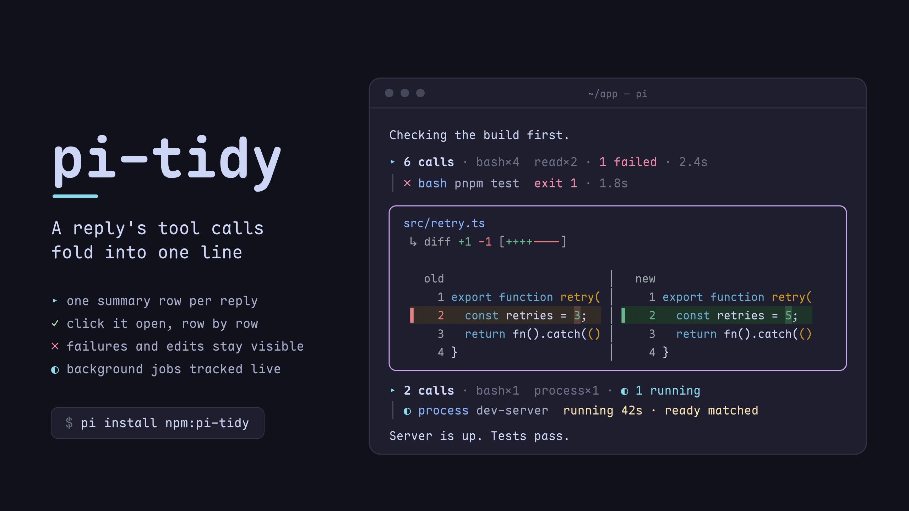
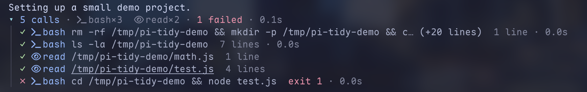
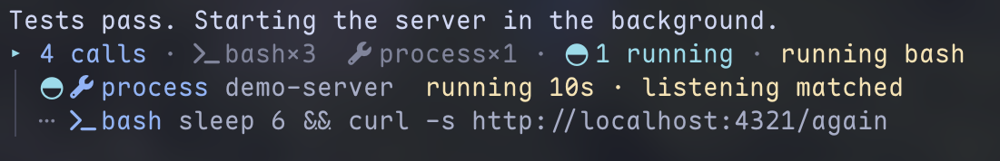

# pi-tidy

<p align="center">
  
</p>

Tool folding for the [pi](https://github.com/earendil-works/pi) coding agent: a reply's tool calls
fold into one line you can click open, while edits, failures and background jobs stay in view — and
every box gets a rounded transparent frame.

**▶ [Watch the 40-second demo](https://cdn.jsdelivr.net/gh/Andy8647/pi-tidy@v0.4.3/assets/demo.mp4)**

## Features

- **Rounded borders** — ╭╮╰╯ box drawing instead of pi's ┌┐└┘, on a transparent background: no fill, so terminal transparency works
- **Every tool box** — built-in tools, MCP calls (pi-mcp-adapter), subagents and any other extension's tools get the same frame, a kind icon, and the tool's own border color on success (pending stays grey, errors red)
- **Turn folding** — a whole run folds to `▸ took 1m20s · LLM 58s · tools 20s · 12 calls · read×6 · bash×4`, and opens to the process it replaced. Steering, retries and continuations stay in the run
- **Grouped tool calls** — the calls between two pieces of assistant text fold to `▸ 5 calls · bash×3 · 1 failed · 1.2s`: click for a row per call under a `│` gutter, click a row for its output underneath, and each row says what the call produced (`12 lines`, `3 matches`, `exit 1`). A failure is counted once in the summary; only a *running* call keeps a row. Edits and writes never fold — their diff is the point
- **Every message box** — compaction, branch, skill and extension custom messages get the same frame, each kind its own border color, its `[kind]` label set into the top border
- **One row per failure** — pi prints its own errors (a failed request, an extension that threw) once per retry attempt, provider body and all; tidy keeps the first row, frames it, and counts the rest as `×N`. Warnings and notes are left alone
- **User messages that fit** — tidy's rounded frame, as wide as the text, with the user icon in its top border; a one-word prompt gets a small box. Or the rail (a rule above and below, an accent `│` in front), or pi's own look
- **Your own `!` commands** — framed in the user color with the `!` you typed, so a `!` run never passes for the agent's bash box
- **Thinking, folded in** — a step that only thinks leaves a `thinking` row inside its group (a brain, the word, one line of what the model thought, sliding over the newest words while it streams); the summary counts the runs (`🧠 5 thoughts`), and a click opens that step's thinking full length, in a framed box with `󰧑 thinking` in its border. pi's `hideThinkingBlock` is ignored on purpose: the row is the same either way, and the click is the one way to read it
- **Background jobs** — a call that starts a pi-processes job shows the job's live state on its row (`◐ process ticker  running 12s · READY matched`, then `✓ … exited 0 · 20s`); its `[process]` notifications are folded into that row, and a click opens the command, working directory and last 20 output lines without expanding the call
- **codemode reads as a call list** — opened, the calls a script ran are tidy rows with a name and a duration column; the script and the output each fold to one row
- **Side-by-side edit diffs** — `old │ new` with line numbers on both sides, a bar and a tint per changed row, the changed word emphasised; below `splitDiffMinWidth` it falls back to pi's unified diff
- **One-line boxes** — a collapsed box keeps `bashResultLines` rows of output under a `(+N more lines, ctrl+o to expand)` footer, so a long call no longer owns the screen
- **Nerd Font icons** — a kind icon per box, and the target file's nvim-web-devicons glyph in front of its path (`write /tmp/x.ts` renders `  write 󰛦 /tmp/x.ts`)
- **Bash syntax highlighting** — token-level colors for commands, flags, strings, variables and operators
- **Click to fold** — clicks land on pi's own expand toggle, for every tool including `renderShell: "self"` ones; only left clicks are taken, so selecting text still works
- **Scroll-safe caching** — an unchanged box costs one string comparison per frame

## Turn folding

On by default since 0.8.0. To go back, merge these keys into the `tidy` object in
`~/.pi/agent/settings.json` and restart pi:

```json
{ "tidy": { "collapseTurns": "off", "frameFinalReply": false } }
```

The keys are independent: `collapseTurns: "live"` folds while the run is still arriving, and
`frameFinalReply: true` works without turn folding.

A run folds to one line, where it started:

```text
 ▸ took 1m20s · LLM 58s · tools 20s · 12 calls · read×6 · bash×4 · codemode×2
```

Click it to open the process, click again to fold. The fold hides thinking and `alwaysShowTools`
boxes, never your own inputs, and reopens with manual expansion, `groupOpen` and output budgets
intact. `/tidy turn` toggles the latest run, `/tidy turn N` the one at that position on the branch;
`ctrl+o` still expands tool outputs and their turns. User inputs, background-job notifications and
pi's error rows stay visible, because the rows that would own them may be hidden. A reply with no
hidden process gets no summary.

`took` is wall time. `LLM` is the main agent's model requests, including response wait. `tools` is
the union of top-level tool intervals (codemode and MCP waits included, parallel and nested calls
not counted twice). Retries and overlap mean the parts need not sum to the total; missing historical
timings show `—`.

Opened, the process hangs on a rail under the summary's marker, and the rail runs into the final
reply's border. A box from `alwaysShowTools` joins the rail of a group that is open right above or
below it. A run that fails with no text keeps the failure in view when it folds.

`frameFinalReply` frames only a settled final text reply, keeping pi's Markdown and mouse targets —
an intermediate tool-calling message is never promoted. The border names the model that answered
(from the message, not the current selection) with its provider glyph, clipped to `…` when it does
not fit, and `icons: false` drops the glyph.

## What it looks like

A reply's tool calls, folded:



A background process (pi-processes), tracked on the row that started it:



Click `▸ 5 calls` and it becomes a `▾` header with one row per call, each step's thinking above it:

```
 ▾ 5 calls ·  bash×3  read×2 · 4 thoughts · 1 failed · 2.4s
 │ 🧠 thinking  测试挂了，先确认是哪一个断言炸的，再看是不是我们这边的问题
 │ ✓  bash git status --short  4 lines · 0.1s
 │ 🧠 thinking  看一眼改了什么
 │ ✓  read src/app.ts  120 lines · 0.0s
 │ ✗  bash pnpm test  exit 1 · 1.8s
 │ 🧠 thinking  …
```

## Installation

```bash
pi install npm:pi-tidy
```

Requires pi ≥ 1.1.0 (component mouse events, tool durations); on an older pi it
says so at session start. Bash highlighting and the custom write preview also need
`pi.registerToolRenderer()` (pi 1.3.0). Without that API they are skipped and Tidy
says so once, rather than falling back to a tool override that would stop another
extension from loading.

Or straight from the repo:

```bash
pi install git:github.com/Andy8647/pi-tidy
```

Restart pi to activate.

### Coming from pi-toolbox

pi-tidy is `@andy8647/pi-toolbox` renamed (from 0.4.2). Swap the package, and
remove the old one first so the two aren't loaded side by side:

```bash
pi remove npm:@andy8647/pi-toolbox
pi install npm:pi-tidy
```

Your `"toolbox"` settings keep working; rename the key to `"tidy"` when convenient.

The old package re-registered `bash` and `write` as its own tools so it could draw
the highlighted command row and the write preview. pi treats a second registration
under a built-in name as a hard failure, so Tidy could not be loaded alongside an
extension that sandboxes or gates those tools, in either load order. Since 0.4.5
both previews travel as `pi.registerToolRenderer()` resolvers instead, which is why
there is nothing left to conflict with (see [How it works](#how-it-works)).

## Releasing

`.github/workflows/publish.yml` publishes to npm on a published GitHub Release,
using npm's Trusted Publisher (OIDC) — no `NPM_TOKEN` secret. Bump `version` in
`package.json`, tag `vX.Y.Z`, and publish the release; the workflow fails fast
if the tag and the manifest version disagree.

## Configuration

Add a `tidy` key to your `~/.pi/agent/settings.json`; changes apply on `/reload`:

```json
{
  "tidy": {
    "enabled": true,
    "highlightBash": true,
    "frameMessages": true,
    "userMessageStyle": "frame",
    "userMessageAlign": "left",
    "collapseTurns": "afterRun",
    "frameFinalReply": true,
    "userMessagePaddingY": 1,
    "userMessageColors": { "rail": "accent", "rule": "borderMuted" },
    "icons": true,
    "bashResultLines": 1,
    "writeLines": 10,
    "diffLines": 20,
    "thinkingColor": "warning",
    "groupTools": true,
    "groupOpen": false,
    "toolRowLines": 1,
    "alwaysShowTools": ["edit", "write"],
    "backgroundJobs": true,
    "hideJobNotifications": true,
    "dedupeErrors": true,
    "toolColors": {
      "bash": "bashMode",
      "read": "toolTitle",
      "edit": "syntaxVariable",
      "write": "syntaxVariable",
      "grep": "syntaxOperator",
      "find": "syntaxOperator",
      "ls": "syntaxOperator",
      "mcp": "customMessageLabel"
    },
    "messageBorderColors": {
      "user": "toolTitle",
      "compaction": "customMessageLabel",
      "branch": "mdCode",
      "skill": "accent",
      "custom": "warning"
    }
  }
}
```

| Key | Type | Default | Description |
|-----|------|---------|-------------|
| `enabled` | boolean | `true` | Enable/disable the extension |
| `highlightBash` | boolean | `true` | Syntax-highlight bash commands |
| `frameMessages` | boolean | `true` | Frame compaction/branch/skill/custom-message boxes like tool boxes, and your own `!` / `!!` bash runs (in the user message color, with the user icon and the `!` you typed) |
| `userMessageStyle` | `"frame"` \| `"rail"` \| `"off"` | `"frame"` | How user messages look. `frame`: the rounded message frame, as wide as the text (never wider than the screen), with the user icon set into its top border, in `messageBorderColors.user` (needs `frameMessages`). `rail`: a full-width rule above and below, an accent `│` in front of every row, and (with `icons`) the user icon in front of the text, later rows hanging under the text. `off`: pi's own. `frameUserMessages` from before 0.5 is no longer read |
| `userMessageAlign` | `"left"` \| `"right"` | `"left"` | Align a `frame` user message and its border icon together. `rail` and `off` are unchanged. Long messages still use the available width |
| `collapseTurns` | `"off"` \| `"afterRun"` \| `"live"` | `"afterRun"` | Fold a whole run's process. `afterRun` waits for final settlement; `live` folds while running and keeps the latest assistant text visible. Works with grouping on or off |
| `frameFinalReply` | boolean | `true` | Put only the settled final assistant reply in a full-width transparent frame, with that message's provider glyph and model name in the top-left border. Independent of turn folding and `frameMessages` |
| `userMessagePaddingY` | number | `1` | Rail-only rows between each rule and the text of a `rail` message, `0`–`3` |
| `userMessageColors` | object | `{ "rail": "accent", "rule": "borderMuted" }` | Colours of the `rail` style's `│` and rules. Each is a theme color name or `#rrggbb` |
| `icons` | boolean | `true` | Nerd Font icons on every box. Requires a Nerd Font; set `false` otherwise |
| `groupTools` | boolean | `true` | Fold the tool calls between two assistant text blocks (or a user message) into one summary line; click it for one row per call, click a row to open its output beneath it (no box inside the group), click the `▾` header to fold the group. `false` renders every call as its own box (a `codemode` box still reads as its call list) |
| `groupOpen` | boolean | `false` | A group's *initial* level: `true` starts each new group open (`▾` header, one row per call) instead of folded to its summary line. Only the level it is born with — clicking the `▾` header or `ctrl+o`'s collapse-all stays folded, and nothing is persisted |
| `toolRowLines` | `1` \| `2` | `1` | Rows a call in an open group may take. With `2`, a call that does not fit goes on to a second row: the rest of a long command, or the next line of a multi-line one. Calls that fit keep one row |
| `backgroundJobs` | boolean | `true` | A call that started a background job (pi-processes) shows the job's live state on its row and in the summary. A *running* job keeps its row while folded; a finished one folds away (the summary counts it). The spinner turns once a second for a job's first 5 minutes, then stands still (a dev server can run for hours) |
| `hideJobNotifications` | boolean | `true` | Don't draw a job's notification messages (`[process] "ticker" matched stdout: READY`) once its row shows them. Only drawing — the model still receives them. Jobs without a row keep their messages |
| `dedupeErrors` | boolean | `true` | pi prints its own error rows — a failed request, an extension that threw — once per retry attempt, provider body and all. Fold the repeats into the first one as `×N` and frame that row (`╭─ error ×3 ─╮`). One row per failure instead of one per attempt. A request that fails for good, with nothing else to show, gets the same framed row; retried attempts that fail the same way share one row with a count, and pi's "Retry failed after N attempts" replaces it when pi gives up. Warnings, notes and an abort stay as pi drew them |
| `alwaysShowTools` | string[] | `["edit", "write"]` | Tools that never fold: they keep their own box (with the diff) and end the group before them, so later calls start a new one. Set `[]` to fold edits and writes into the group like everything else — click their row for the box |
| `splitDiff` | boolean | `true` | Render an edit's diff as two panes (`old │ new`) with line numbers, a bar and a tinted row per changed line. `false` keeps pi's unified diff |
| `splitDiffMinWidth` | number | `72` | Box width below which the split is dropped for pi's unified diff — two panes need room to stay readable |
| `thinkingColor` | theme color | `warning` | Colour of the brain, the `N thoughts` count and an expanded thinking box. Any theme color name or `#rrggbb` |
| `diffLines` | number | `20` | Diff rows drawn while an edit box is collapsed. The window is anchored at the first changed line (a third of the budget of context above it), with `… (N more lines, M total, ctrl+o to expand)` under it — pi's own edit renderer has no budget at all, so this is the only thing keeping a long diff from owning the screen. `ctrl+o` draws all of it, `0` keeps just the summary row |
| `bashResultLines` | number | `1` | Visual lines of bash *output* shown while collapsed. pi's renderer hard-codes 5 with no setting; raise this for more context, `0` to hide output until you expand |
| `writeLines` | number | `10` | Visual lines of a written file shown while the box is collapsed (pi's own number, now adjustable). `0` keeps just the header until you expand. Requires Pi's `registerToolRenderer` API |
| `toolColors` | object | see above | Border color per tool name for successful executions (pending stays grey, errors stay red, unlisted tools take `accent`). When set, the map **replaces** the defaults — `{}` disables per-tool colors |
| `messageBorderColors` | object | see above | Per-kind message-box border colors; merged over the defaults |

All color values are theme fg color names (`ThemeColor`), so they follow the
active theme. Default palette rationale: tool boxes reserve green/red/grey for
execution status, so message kinds get hues that don't collide —
`customMessageLabel` (mauve, matching the `[compaction]` label) for
compactions, `mdCode` (peach) for branch summaries, `accent` (sky) for skill
invocations, `warning` (yellow) for extension notices. For right-aligned user frames, set
`userMessageAlign: "right"` with `userMessageStyle: "frame"` and `frameMessages: true`.

## How it works

pi builds one `ToolExecutionComponent` per tool call, no matter which extension
registered the tool. pi-tidy patches that component's `render` to frame the whole
box — which is why MCP and subagent boxes are framed too. Message boxes (compaction, branch
summary, skill invocation, extension custom message) never go through that
component; their own prototypes get the same treatment, with one exception
that keeps its native styling: custom messages rendered by an
extension-provided renderer. Their `[compaction]` / `[branch]` / `[skill]` /
`[type]` row is a title, so it sits in the top border next to the kind icon and
the spacer under it is gone; a collapsed skill box keeps its label inline, where
it shares the row with the skill's name. `!` bash-mode runs are framed as the user's
rather than as a tool's: the agent's bash box changes color with its state,
while the user's keeps the user messages' color (`messageBorderColors.user`, or
`userMessageColors.rail` under the rail) and lets pi's own rows (`Running...`,
`(exit 1)`) say how it went. Both user message styles render pi's own Markdown
child narrower and swap only its chrome, so markdown
transformers registered by other extensions (pi-ide-context's selection
references, for one) keep working. With pi-starline 0.9 and later, tidy is the
only extension that styles user messages; earlier pi-starline versions draw
their own over it.

Tidy registers **no tools at all**. Everything it changes about `bash` and `write`
(the highlighted command row, the collapsed output budgets, the write preview)
travels as a `pi.registerToolRenderer()` resolver, so the tool that is actually
installed keeps its execution, schema, shell and result renderer, and `next()`
hands Tidy whatever is downstream — pi's built-in renderers when an extension
defines none. Registering a tool under a built-in name is a hard failure in pi
(`Tool "write" conflicts with …`), which is why an extension that sandboxes
`bash`/`write` used to be mutually exclusive with Tidy no matter which loaded
first. It no longer is (issue #7, PR #8 and the bash follow-up).

An unchanged box returns its cached line array outright: pi re-renders the
whole transcript on every frame, including every mouse packet while scrolling.
Measured against unpatched pi at 300 boxes / 2400 lines: +0.03 ms per full
render.

pi's own error rows — `Error: 429: …`, an extension that threw — have no
patchable prototype: they are `ThemedText`, which pi does not export. That seam
is the chat container instead. After `InteractiveMode.init`, its `addChild` is
wrapped: a row painted in the error colour that repeats the previous one folds
into it as `×N`, and the survivor gets the frame. If a future pi renames `init`,
the hook stays uninstalled and those rows render exactly as pi draws them — the
behaviour before 0.7.2, not a crash.

### Grouping

Groups are derived at render time from transcript order — nothing is
persisted, so a reloaded session folds the same way. A boundary is a user
message or an assistant message with visible text; pi gives every model step its
own assistant message, and steps that only call a tool don't split a group.
`ctrl+o` and pi's own box clicks both arrive through `setExpanded`, which is how
the group levels stay in step with pi's per-box expand flag.

### Background jobs

pi has no notion of a job that outlives its tool call, so `background-jobs.ts`
has a small provider interface. pi-processes is the one provider: its
`processes:*` events on pi's shared extension bus keep a row live, its persisted
`ad-process:notification` messages rebuild a reloaded session, and a process it
no longer knows reads `not running`. If that protocol changes, rows fall back to
plain tool rows.

### Mouse

Clicks come from pi's own fullscreen mode (`tuiMode: "fullscreen"`, pi ≥ 0.86
component mouse events); pi-tidy never turns on mouse reporting itself. Only left
clicks on its own rows are taken — presses and drags pass through, so text
selection works as usual. Without fullscreen there are no clicks: `ctrl+o` still
toggles every box.

A row you can click lights up under the pointer, and the pointer turns into a hand
while it is on one (OSC 22: Ghostty, kitty, foot and WezTerm draw it; other
terminals ignore it). Under tmux, zellij or screen pi only reports motion with a button
held, so there is no hover there.

The transcript's scrollbar is pi's, and with `fullscreenScrollbar: "auto"` (the
default) pi paints it over the rightmost column — the one these frames put their
border in, so it covers the border while it is on screen. Set `"always"` and pi
reserves that column instead, drawing the frames one cell narrower; `"hidden"`
works too if you never want it. Nothing to configure on this side either way.

## Render benchmark

PRs include a **Render benchmark** check. Its Job Summary compares the PR's base and head
commits on the same runner using the same fixture and installed dependencies. It reports
median and P95 milliseconds per frame at 100, 500 and 1,500 components, folded and with all
tool outputs expanded. Raw samples are attached as an artifact. Timing changes do not fail CI.

The fixture uses real pi components with synthetic user messages, thinking, tool groups,
failures, edit diffs and codemode calls. It never executes tools or contacts a model.
Measurements cover warm transcript rendering, not terminal drawing or end-to-end scroll latency;
small differences can be runner noise. For a local comparison, run `pnpm bench /path/to/base-checkout`
from the PR checkout. Both checkouts must resolve the PR checkout's installed dependencies.

## Compatible themes

For the best transparent experience, set tool background colors to `""` in your theme:

```json
{
  "toolPendingBg": "",
  "toolSuccessBg": "",
  "toolErrorBg": ""
}
```

## License

MIT
